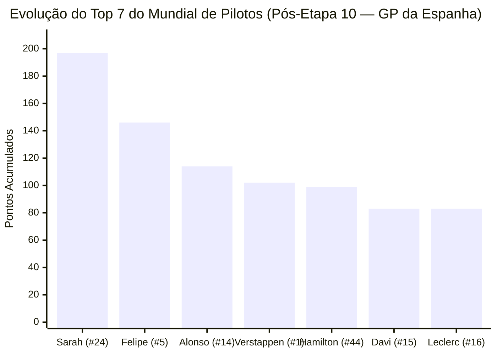

# FEDERATION INTERNATIONALE DE L'AUTOMOBILE (FIA)
## OFFICIAL CHAMPIONSHIP BULLETIN — POST ROUND 10 (GP DA ESPANHA)
### ATUALIZAÇÃO OFICIAL DO CAMPEONATO MUNDIAL DE PILOTOS E CONSTRUTORES (TEMPORADA 2026)

* **DOCUMENTO Nº:** `FIA-F1-2026-STG10-CHAMPIONSHIP-STANDINGS`
* **ETAPA CONCLUÍDA:** Etapa 10 de 24 — Grande Prêmio da Espanha (Circuit de Barcelona-Catalunya)
* **PRÓXIMA ETAPA:** Etapa 11 de 24 — Grande Prêmio da Áustria (Red Bull Ring, Spielberg — *Formato Sprint*)
* **DELEGADO TÉCNICO DA FIA:** Jo Bauer
* **MOTOR DE AUDITORIA:** `fia_calculator.py` (Zero Cálculo por LLM — Homologação Determinística Opção 1)
* **STATUS:** RATIFICADO E HOMOLOGADO PELO CONSELHO MUNDIAL DO ESPORTE A MOTOR (WMSC)

---

## 1. RESUMO EXECUTIVO E MOVIMENTAÇÕES TECTÔNICAS NA TABELA

O encerramento da 10ª etapa da temporada 2026 em Barcelona-Catalunya consolidou a hegemonia histórica da chamada *"Brazilian Storm"* e provocou mudanças estruturais nas disputas diretas pelo Top 6 do Mundial de Pilotos e pelo Vice-Campeonato Mundial de Construtores:

1. **A Disparada Imperial de Sarah (`#24` Mercedes-AMG — 197 pts):** Com seu *Hat-Trick* na Espanha (Pole, Vitória e Volta Mais Rápida de `1:17.035`), Sarah somou a pontuação máxima de `26 pontos`, saltando de `171` para **`197 pontos`** (6 vitórias, 7 pódios, 6 poles e 5 voltas mais rápidas em 10 etapas). Sua vantagem na liderança sobre o vice-líder **Felipe (`146 pts`)** ampliou-se de 40 para **`51 pontos`** — o equivalente a quase duas vitórias completas com volta rápida de margem antes do fim de semana com Corrida Sprint na Áustria.
2. **Felipe Consolida a Vice-Liderança Isolada (`#5` KICK Sauber — 146 pts):** Ao garantir o 3º lugar (`+15 pts`), o patriarca brasileiro chegou a **`146 pontos`** (2 vitórias e 7 pódios), abrindo **`32 pontos` de frente sobre Fernando Alonso (`3º`, 114 pts)** e **`44 pontos` sobre Max Verstappen (`4º`, 102 pts)**.
3. **Verstappen Ultrapassa Hamilton pelo 4º Lugar (`102` vs `99 pts`):** Mesmo limitado ao 6º lugar em Barcelona (`+8 pts`), Max Verstappen (`102 pts`) superou Lewis Hamilton (`9º` na corrida, `+2 pts`, totalizando `99 pts`) para assumir a 4ª colocação do Mundial de Pilotos (`▲ +1`).
4. **Davi Assume o 6º Lugar no Mundial Superando Leclerc nos Critérios da FIA (`83` vs `83 pts`):** O 2º lugar de **Davi (`#15` Williams, `+18 pts`)** aliado ao 11º lugar sem pontos de **Charles Leclerc (`#16` Ferrari, `+0 pts`)** deixou ambos rigorosamente empatados com **`83 pontos`**. Em aplicação estrita do **Artigo 9.2 do Regulamento Esportivo da FIA** (critério de desempate por melhores resultados na temporada), ambos possuem zero vitórias, mas **Davi soma `4 pódios` (três 2ºs lugares — Bahrein, Canadá e Espanha — e um 3º lugar em Miami) contra apenas `2 pódios` de Leclerc**. Assim, Davi salta oficialmente para o **6º lugar do Mundial (`▲ +1`)**, empurrando o monegasco da Ferrari para o 7º posto (`▼ -1`)!
5. **Guerra de Construtores:** A **Mercedes-AMG (`296 pts`)** aproxima-se da barreira dos 300 pontos. Na luta pelo 2º lugar, a **KICK Sauber (`146 pts`)** ampliou sua vantagem sobre a **Red Bull Racing (`135 pts líquidos` após a dedução WMSC de `-10 pts` / `145 pts brutos`)** de 8 para **`11 pontos`**, enquanto a **McLaren (`128 pts`, `+18` na Espanha com Piastri em 4º e Norris em 7º)** encostou a apenas `7 pontos` da Red Bull. Já a **Williams (`83 pts`)**, impulsionada exclusivamente por Davi, reduziu a distância para a 6ª colocada **Ferrari (`99 pts`)** de 33 para apenas **`16 pontos`**!

---

## 2. CLASSIFICAÇÃO OFICIAL DO MUNDIAL DE PILOTOS (PÓS-ETAPA 10)

| Pos. (Var.) | Nº | Piloto | Nac. | Equipe (Construtor) | Pts. Ant. (Et. 9) | Pts. Espanha (Et. 10) | **Total Acumulado** | Vitórias | Pódios | Poles | VRs | Histórico R1–R10 |
| :---: | :---: | :--- | :---: | :--- | :---: | :---: | :---: | :---: | :---: | :---: | :---: | :--- |
| **1º** (`=`) | `#24` | **Sarah (SarahMarinsS)** | 🇧🇷 BRA | **Mercedes-AMG Petronas** | 171 | **+26** *(1º+VR)* | **197** | **6** | **7** | **6** | **5** | `26, 0, 25, 26, 25, 18, 26, 0, 25, 26` |
| **2º** (`=`) | `#5` | **Felipe (frdsilva)** | 🇧🇷 BRA | **Stake F1 Team Kick Sauber** | 131 | **+15** *(3º)* | **146** | **2** | **7** | **1** | **3** | `0, 26, 19, 12, 18, 26, 15, 0, 15, 15` |
| **3º** (`=`) | `#14` | **Fernando Alonso** | 🇪🇸 ESP | **Aston Martin Aramco** | 104 | **+10** *(5º)* | **114** | 1 | 3 | 0 | 0 | `0, 15, 6, 18, 6, 12, 12, 25, 10, 10` |
| **4º** (`▲ +1`) | `#1` | **Max Verstappen** | 🇳🇱 NED | **Red Bull Racing** | 94 | **+8** *(6º)* | **102** | 0 | 2 | 0 | 0 | `12, 10, 15, 10, 10, 10, 8, 15, 4, 8` |
| **5º** (`▼ -1`) | `#44` | **Lewis Hamilton** | 🇬🇧 GBR | **Mercedes-AMG Petronas** | 97 | **+2** *(9º)* | **99** | 0 | 3 | 0 | 0 | `15, 18, 2, 8, 8, 6, 10, 18, 12, 2` |
| **6º** (`▲ +1`)* | `#15` | **Davi (DaviMSSon)** | 🇧🇷 BRA | **Williams Racing** | 65 | **+18** *(2º)* | **83** | 0 | **4** | **1** | **2** | `18, 0, 0, 0, 13, 15, 0, 0, 19, 18` |
| **7º** (`▼ -1`)* | `#16` | **Charles Leclerc** | 🇲🇨 MON | **Scuderia Ferrari HP** | 83 | **0** *(11º)* | **83** | 0 | 2 | 0 | 0 | `10, 12, 8, 4, 15, 2, 18, 6, 8, 0` |
| **8º** (`=`) | `#4` | **Lando Norris** | 🇬🇧 GBR | **McLaren Formula 1 Team** | 59 | **+6** *(7º)* | **65** | 0 | 1 | 0 | 0 | `1, 8, 10, 15, 4, 1, 2, 12, 6, 6` |
| **9º** (`=`) | `#81` | **Oscar Piastri** | 🇦🇺 AUS | **McLaren Formula 1 Team** | 51 | **+12** *(4º)* | **63** | 0 | 0 | 0 | 0 | `6, 4, 12, 6, 1, 4, 6, 10, 2, 12` |
| **10º** (`=`) | `#11` | **Sergio Pérez** | 🇲🇽 MEX | **Red Bull Racing** | 39 | **+4** *(8º)* | **43** | 0 | 0 | 0 | 0 | `8, 6, 4, 1, 0, 8, 4, 8, 0, 4` |
| **11º** (`=`) | `#55` | **Carlos Sainz** | 🇪🇸 ESP | **Scuderia Ferrari HP** | 15 | **+1** *(10º)* | **16** | 0 | 0 | 0 | 0 | `4, 1, 1, 2, 2, 0, 0, 4, 1, 1` |
| **12º** (`=`) | `#10` | **Pierre Gasly** | 🇫🇷 FRA | **BWT Alpine F1 Team** | 6 | **0** *(13º)* | **6** | 0 | 0 | 0 | 0 | `2, 2, 0, 0, 0, 0, 0, 2, 0, 0` |
| **13º** (`=`) | `#27` | **Nico Hülkenberg** | 🇩🇪 GER | **MoneyGram Haas F1 Team** | 1 | **0** *(18º)* | **1** | 0 | 0 | 0 | 0 | `0, 0, 0, 0, 0, 0, 0, 1, 0, 0` |
| **14º** (`=`) | `#18` | **Lance Stroll** | 🇨🇦 CAN | **Aston Martin Aramco** | 1 | **0** *(NC)* | **1** | 0 | 0 | 0 | 0 | `0, 0, 0, 0, 0, 0, 1, 0, 0, 0` |
| **15º** (`=`) | `#23` | **Alexander Albon** | 🇹🇭 THA | **Williams Racing** | 0 | **0** *(15º)* | **0** | 0 | 0 | 0 | 0 | `0, 0, 0, 0, 0, 0, 0, 0, 0, 0` |
| **16º** (`=`) | `#22` | **Yuki Tsunoda** | 🇯🇵 JPN | **Visa Cash App RB** | 0 | **0** *(12º)* | **0** | 0 | 0 | 0 | 0 | `0, 0, 0, 0, 0, 0, 0, 0, 0, 0` |
| **17º** (`=`) | `#31` | **Esteban Ocon** | 🇫🇷 FRA | **BWT Alpine F1 Team** | 0 | **0** *(16º)* | **0** | 0 | 0 | 0 | 0 | `0, 0, 0, 0, 0, 0, 0, 0, 0, 0` |
| **18º** (`=`) | `#3` | **Daniel Ricciardo** | 🇦🇺 AUS | **Visa Cash App RB** | 0 | **0** *(14º)* | **0** | 0 | 0 | 0 | 0 | `0, 0, 0, 0, 0, 0, 0, 0, 0, 0` |
| **19º** (`=`) | `#77` | **Valtteri Bottas** | 🇫🇮 FIN | **Stake F1 Team Kick Sauber** | 0 | **0** *(19º)* | **0** | 0 | 0 | 0 | 0 | `0, 0, 0, 0, 0, 0, 0, 0, 0, 0` |
| **20º** (`=`) | `#20` | **Kevin Magnussen** | 🇩🇰 DEN | **MoneyGram Haas F1 Team** | 0 | **0** *(17º)* | **0** | 0 | 0 | 0 | 0 | `0, 0, 0, 0, 0, 0, 0, 0, 0, 0` |

> `*` **Nota de Desempate Oficial FIA (Art. 9.2):** **Davi (`#15` Williams)** ocupa a **6ª colocação** à frente de **Charles Leclerc (`#16` Ferrari)**, ambos com `83 pontos`, pelo maior número de pódios conquistados na temporada (`4 pódios` de Davi contra `2 pódios` de Leclerc). Pelo mesmo artigo, **Nico Hülkenberg (`#27` Haas)** precede **Lance Stroll (`#18` Aston Martin)** em 13º lugar (ambos com `1 ponto`) por melhores colocações gerais fora da zona de pontuação.

---

## 3. CLASSIFICAÇÃO OFICIAL DO MUNDIAL DE CONSTRUTORES (PÓS-ETAPA 10)

| Pos. (Var.) | Equipe (Construtor) | Dupla de Pilotos | Pts. Ant. (Et. 9) | Pts. Espanha (Et. 10) | Pts. Brutos | Deduções WMSC FIA | **Total Líquido Oficial** | Vitórias | Status / Desempenho |
| :---: | :--- | :--- | :---: | :---: | :---: | :---: | :---: | :---: | :--- |
| **1º** (`=`) | **Mercedes-AMG Petronas F1 Team** | Sarah (`197`) / Hamilton (`99`) | 268 | **+28** | 296 | `0` | **296** | **6** | Liderança isolada (`+150 pts` de margem) |
| **2º** (`=`) | **Stake F1 Team Kick Sauber** | Felipe (`146`) / Bottas (`0`) | 131 | **+15** | 146 | `0` | **146** | **2** | Vice-líder isolada; `100%` dos pontos por Felipe |
| **3º** (`=`) | **Red Bull Racing** | Verstappen (`102`) / Pérez (`43`) | 123 | **+12** | 145 | **`-10`**¹ | **135** | 0 | A `11 pts` da Sauber; pressionada pela McLaren |
| **4º** (`=`) | **McLaren Formula 1 Team** | Norris (`65`) / Piastri (`63`) | 110 | **+18** | 128 | `0` | **128** | 0 | Dupla mais equilibrada; a `7 pts` do 3º lugar |
| **5º** (`=`) | **Aston Martin Aramco F1 Team** | Alonso (`114`) / Stroll (`1`) | 105 | **+10** | 115 | `0` | **115** | 1 | Sustentada por Alonso; Stroll abandonou (`NC`) |
| **6º** (`=`) | **Scuderia Ferrari HP** | Leclerc (`83`) / Sainz (`16`) | 98 | **+1** | 99 | `0` | **99** | 0 | Pior pontuação do Top 7 na Espanha (`+1 pt`) |
| **7º** (`=`) | **Williams Racing** | Davi (`83`) / Albon (`0`) | 65 | **+18** | 83 | `0` | **83** | 0 | Encosta a `16 pts` da Ferrari; `100%` por Davi |
| **8º** (`=`) | **BWT Alpine F1 Team** | Gasly (`6`) / Ocon (`0`) | 6 | **0** | 6 | `0` | **6** | 0 | Sem pontuar desde Mônaco |
| **9º** (`=`) | **MoneyGram Haas F1 Team** | Hülkenberg (`1`) / Magnussen (`0`) | 1 | **0** | 1 | `0` | **1** | 0 | Mantém 9º posto pelo ponto de Mônaco |
| **10º** (`=`) | **Visa Cash App RB F1 Team** | Tsunoda (`0`) / Ricciardo (`0`) | 0 | **0** | 0 | `0` | **0** | 0 | Única equipe zerada após 10 etapas |

> ¹ **Dedução WMSC FIA (`-10 pts` Construtores — Red Bull Racing):** Sanção disciplinar irrecorrível aplicada pelo Conselho Mundial do Esporte a Motor da FIA devido à colisão antidesportiva na saída do Túnel no GP de Mônaco (Etapa 8), conforme dossiê de telemetria homologado.

---

## 4. PARECER DO DELEGADO TÉCNICO (JO BAUER) E REPERCUSSÃO DOS CHEFES DE EQUIPE

> [!IMPORTANT]
> **PARECER DE HOMOLOGAÇÃO E PROJEÇÃO PARA A ETAPA 11 (GP DA ÁUSTRIA — SPRINT):**
> - **Auditoria Matemática Concluída:** Todos os somatórios individuais e coletivos foram verificados contra as matrizes `points_by_round` de Etapas 1 a 10. O total de pontos distribuídos em Barcelona foi de exatos **102 pontos** (`26 + 18 + 15 + 12 + 10 + 8 + 6 + 4 + 2 + 1`).
> - **Alerta de Formato Sprint (Etapa 11 — Red Bull Ring):** A próxima etapa em Spielberg contará com o formato **Corrida Sprint** (distribuindo `8-7-6-5-4-3-2-1` pontos extras no sábado, além dos `26` pontos máximos do GP de domingo, totalizando **34 pontos máximos em jogo**).

### Declarações Oficiais dos Chefes de Equipe após a Publicação do Boletim:
- **Toto Wolff (Mercedes-AMG — 1º com 296 pts):** *"Chegar a 296 pontos na 10ª corrida e ver a Sarah abrir 51 pontos na liderança com apenas 16 anos é algo que me lembra os anos mais dominantes da nossa história em Brackley. Precisamos agora recuperar a confiança do Lewis no acerto traseiro para a Sprint na Áustria."*
- **Mattia Binotto (KICK Sauber — 2º com 146 pts):** *"O Felipe não apenas nos mantém isolados no vice-campeonato de pilotos e construtores à frente da Red Bull, como hoje a nossa equipe de box provou que é a mais rápida do mundo com `2.434s`. Agora precisamos urgentemente que o carro `#77` do Valtteri encontre performance para ajudar o Felipe nessa guerra."*
- **Christian Horner (Red Bull Racing — 3º com 135 pts):** *"Perder mais terreno para a Sauber e ver a McLaren a 7 pontos de nós não faz parte do padrão Red Bull. A próxima corrida é na nossa casa, no Red Bull Ring, com Corrida Sprint e 34 pontos na mesa. Não aceitaremos menos que a vitória."*
- **James Vowles (Williams Racing — 7º com 83 pts):** *"Ver o Davi assumir o 6º lugar do Mundial de Pilotos empatado com Charles Leclerc e colocar a Williams a 16 pontos da Ferrari no Mundial de Construtores mostra a dimensão do talento que temos no carro `#15`."*
- **Frédéric Vasseur (Scuderia Ferrari HP — 6º com 99 pts):** *"Sair de Barcelona com apenas 1 ponto do Carlos, ver o Charles fora do Top 10 e sentir a Williams no nosso retrovisor é um choque de realidade inaceitável para Maranello."*

---
*Assinado digitalmente por:*
**Jo Bauer** — *FIA Formula 1 Technical Delegate*
**Secretaria Desportiva do Campeonato Mundial de Fórmula 1 da FIA**

