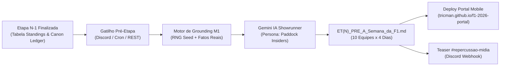
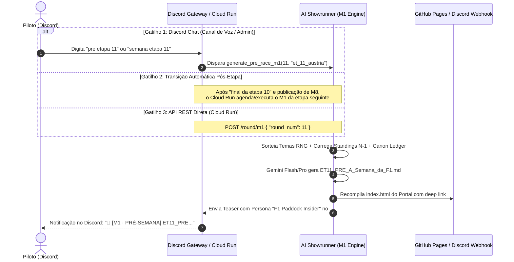

# MÓDULO 1: ARQUITETURA, GATILHOS E ENGENHARIA DO PRÉ-GP (M1 · A SEMANA DA F1)

---

## 1. Visão Geral e Propósito do Módulo #1

O **Módulo #1 (M1 · A Semana da F1 / Especial Silly Season)** é o componente de **Storytelling Preditivo e Pré-Corrida** do ecossistema F1 Showrunner. Ele atua no intervalo entre o fim da corrida anterior ($N-1$) e o início das atividades de pista da próxima etapa ($N$).

Seu objetivo é **construir o drama, a rivalidade e o contexto político-técnico** antes que qualquer piloto humano (Felipe, Davi ou Sarah) acelere no simulador EA F1 24.



---

## 2. Anatomia Narrativa do M1 (Segunda a Quinta-Feira)

O M1 simula o blog clandestino e respeitado de bastidores **"A F1 Que Você Não Vê"**, operado por um consórcio de informantes anônimos espalhados pelo globo:
* 🇬🇧 **The Paddock Mole** (Londres, Milton Keynes e Montreal)
* 🇮🇹 **Lady Paddock & Il Cavallino Spia** (Maranello, Mônaco e Faenza)
* 🇪🇸 **El Chisme de Montmeló** (Espanha e América Latina)
* 🇩🇪 **The Silver Bullet** (Brackley, Stuttgart e Hinwil)

### Estrutura Diária por Equipe (10 Construtores)
Para cada uma das 10 equipes da temporada 2026, o M1 detalha cronologicamente:

```
Segunda-feira ──► A Ressaca da Corrida Anterior & Crise de Telemetria
Terça-feira   ──► Festas VIP, Micos de Marketing & Sondagens Contratuais
Quarta-feira  ──► Pânico no Simulador, Fábrica & Negociações de Bastidores
Quinta-feira  ──► Desembarque no Paddock do Novo GP & Clima nas Hospitalidades
                   │
                   ▼
               SÍNTESE DOS INSIDERS (Pressão da Equipe)
                   │
                   ▼
               5 COMENTÁRIOS DE INTERNAUTAS (@fans, memes e ironias)
```

---

## 3. Matriz de Grounding Anti-Alucinação (Tríplice Camada)

Para evitar alucinações de IA e garantir que as intrigas façam sentido estrito com a realidade da liga, o gerador do M1 amarra:

| Camada | Fonte de Dados | Função no Módulo M1 |
| :--- | :--- | :--- |
| **1. Ground Truth Numérico** | `data/state/standings.json` | Pontuação real, posições exatas nos Construtores e Pilotos após a Etapa $N-1$. Proibido inventar dados de pontuação. |
| **2. Memória Canônica** | `data/state/canon_ledger.json` | Punições vigentes da FIA, toques de pista não resolvidos, disputas de contrato da *Brazilian Storm*. |
| **3. Sorteador RNG Determinístico** | `sample_weekly_themes(round, team)` | Sorteia 4 temas distintos por equipe sem repetição via semente matemática `season_2026_r{N}_{team_id}`. |

### Banco de Temas da Silly Season:
1. `Glamour & Celebridades`: Galas de luxo, iates, estreias e flagras com astros pop.
2. `Silly Season & Crise Contratual`: Reuniões secretas em motorhomes, multas rescisórias, sondagens.
3. `Treta & Vestiário`: Discussões vazadas por garçons em restaurantes VIP, climão no hospitality.
4. `Marketing & Mico Corporativo`: Vídeos de TikTok forçados, ativismos constrangedores de patrocinador.
5. `Entrevista Surpresa / Flagra de Tabloid`: Microfone aberto, áudios vazados de engenheiro.
6. `Preparação & Simulador`: Brigas de acerto na fábrica, turnos triplos de madrugada.

---

## 4. Quais são os Gatilhos do M1? (Como se Inicia o Pré)

O ciclo pré-corrida de uma nova etapa pode ser acionado por três caminhos complementares:



### Gatilho A: Mensagem no Discord (Interativo)
No mesmo canal de voz `#1457392708355096580`:
* `inicio semana etapa 11`: Ativa o agendador episódico da Silly Season (dispara o Dia 1 imediatamente).
* `avancar dia` ou `dia 2 etapa 11`: Avança o episódio diário subsequente (Dia 1 a 4).
* `pre etapa 11`: Gera a edição consolidada completa do Módulo 1 em bloco único.
* `coletiva etapa 11`: Convoca a **Coletiva Interativa da FIA** com Trava de Turno no Discord.

### Gatilho B: Endpoint HTTP (Cloud Run)
```bash
# Episódio Diário do M1 (1 a 4)
POST https://f1-showrunner-service-267450575916.southamerica-east1.run.app/round/m1/day
Content-Type: application/json

{
  "round_num": 11,
  "round_folder": "et_11_austria",
  "day": 1
}

# Iniciar Coletiva Interativa (M2)
POST https://f1-showrunner-service-267450575916.southamerica-east1.run.app/round/coletiva
Content-Type: application/json

{
  "round_num": 11,
  "round_folder": "et_11_austria"
}
```

---

## 5. Calendário Episódico da Silly Season (M1 Diário)

| Dia | Fase Semanal | Foco Narrativo | Gatilho Rápido |
| :--- | :--- | :--- | :--- |
| **Dia 1** | Segunda-Feira | **Ressaca & Diagnóstico Técnico:** Danos da etapa anterior, protestos de telemetria, desgaste de PU. | `dia 1` |
| **Dia 2** | Terça-Feira | **Galas VIP & Bastidores de Patrocinador:** Jantares corporativos, pressões de acionistas, marcas ativadas. | `dia 2` |
| **Dia 3** | Quarta-Feira | **Fábrica & Crises Contratuais:** Sessões de simulador, rumores de cláusulas de rescisão e reuniões a portas fechadas. | `dia 3` |
| **Dia 4** | Quinta-Feira | **Desembarque & Clima Pré-Pista:** Farpas no paddock, memes e reações de internautas/Reddit. | `dia 4` |

---

## 6. Coletiva de Imprensa Oficial da FIA (M2 Interativo com Trava de Turno)

1. **Convocação da Bancada:** 5 a 6 pilotos sorteados (Sarah, Felipe, Davi + rivais da IA como Verstappen, Leclerc ou Norris).
2. **Perguntas Jornalísticas:** Mariana Becker, Erik van Haren, Martin Brundle, Julianne Cerasoli e Roberto Chinchero.
3. **Trava de Turno para Pilotos Humanos:**
   - Para pilotos da IA, o Showrunner gera resposta instantânea com base no humor e perfil psicológico.
   - Para pilotos humanos (**@frdsilva83**, **@DaviMSSon**, **@SarahMarinsS**), o bot marca o piloto e **trava o turno**, aguardando a resposta real no chat do Discord.
   - Assim que o piloto digita sua resposta, o Gemini avalia o impacto na sala de imprensa (reação dos jornalistas, sorrisos amarelos dos rivais, cochichos) e prossegue para a próxima pergunta.
4. **Relatório Oficial:** Ao término da rodada de perguntas, o relatório completo formatado pela FIA é gerado, salvo em Markdown e commitado no Portal!

