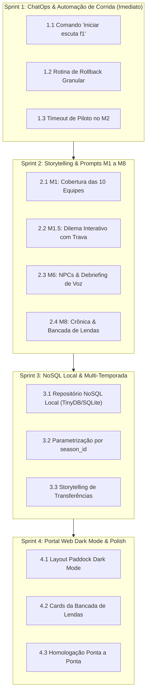

# Plano de Implementação: Showrunner F1 2026 (As-Built Roadmap)
**Documento de Origem:** `docs/ESPECIFICACAO_FUNCIONAL_SHOWRUNNER_F1.docx` (v2.2.0)  
**Status:** Planejado | **Linha de Base:** Especificação Aprovada  
**Liderança Técnica:** Desenvolvedor Sênior / Engenheiro de Solução  
**Meta Operacional:** Habilitar 100% dos requisitos aprovados preservando a integridade da Etapa 11 (Áustria) e das etapas concluídas (Etapas 01 a 10).  

---

## 1. Matriz de Rastreabilidade: Especificação Aprovada vs. Código Atual (Gap Analysis)

| ID Requisito | Funcionalidade na Especificação Aprovada | Estado no Código Atual | Severidade / Esforço |
| :---: | :--- | :---: | :---: |
| **REQ-01** | Catálogo das 12 Verticais Temáticas da Silly Season | ✅ Implementado em `src/canon_ledger.py` | Baixo (Concluído) |
| **REQ-02** | Cobertura M1 de todas as 10 Equipes (Reais e NPCs) | ✅ Implementado em `src/ai_showrunner.py` | Médio (Concluído no Sprint 2) |
| **REQ-03** | Módulo M1.5: Dilema Interativo de Paddock com Trava de Turno | ✅ Implementado em `src/ai_showrunner.py` e `discord_gateway.py` | Médio (Concluído no Sprint 2) |
| **REQ-04** | Coletiva M2: Contingência por Timeout de Piloto via IA | ✅ Implementado (`force_timeout_answer` + fallback Gemini) | Baixo (Concluído no Sprint 1) |
| **REQ-05** | Ingestão UDP 20777 e Descarte de Slots Residuais (`m_numActiveCars`) | ✅ Implementado em `src/telemetry/session_recorder.py` | Baixo (Concluído) |
| **REQ-06** | Ingestão de Áudios de Debriefing de Voz nos Módulos M5 e M6 | ✅ Implementado (`debrief_text` encadeado nos prompts) | Médio (Concluído no Sprint 2) |
| **REQ-07** | M6 Ato 4: Declarações de Pilotos NPCs Relevantes | ✅ Implementado em `prompts/06_cerimonia_podio.md` | Baixo (Concluído no Sprint 2) |
| **REQ-08** | M7: Cálculo Determinístico e Dispensa de Imagem PNG | ✅ Implementado (basta suprimir renderizador PNG) | Baixo (0.5 hora) |
| **REQ-09** | M8: Crônica de Corrida + Bancada de Lendas (Prost, Mansell, Villeneuve) | ✅ Implementado em `prompts/08_repercussao_midia.md` e personas | Médio (Concluído no Sprint 2) |
| **REQ-10** | ChatOps: Comando `iniciar escuta f1` para o Listener UDP | ✅ Implementado em `discord_gateway.py` e `orchestrator_cli.py` | Médio (Concluído no Sprint 1) |
| **REQ-11** | ChatOps: Rotina de Rollback Granular de Etapa (`rollback etapa XX`) | ✅ Implementado em `orchestrator_cli.py` com 4 escopos e trava | Médio (Concluído no Sprint 1) |
| **REQ-12** | Persistência: Base NoSQL Local Unificada (TinyDB / SQLite Document) | ❌ Não Implementado (JSONs puros atuais) | Alto (4 horas) |
| **REQ-13** | Arquitetura Multi-Temporada (Particionamento por `season_id`) | ⚠️ Parcial (pastas `season_01` fixas em código) | Médio (2.5 horas) |
| **REQ-14** | Portal Web: Design Paddock Dark Mode & Navegação por Abas | ⚠️ Parcial (layout funcional, falta tema dark F1) | Médio (3 horas) |

---

## 2. Cronograma de Execução em 4 Sprints Técnicos

---

## 3. Detalhamento dos Pacotes de Trabalho (Work Packages)

### Sprint 1: ChatOps & Automação Operacional (Habilitação da Etapa 11) — ✅ CONCLUÍDO
* **Atividade 1.1 — Comando `iniciar escuta f1`:** ✅
  * Arquivos: `src/discord_gateway.py`, `src/orchestrator_cli.py`, `tests/test_sprint1.py`.
  * Status: Implementado. Comandos `iniciar escuta f1`, `status telemetria` e `parar escuta f1` habilitados no ChatOps e via CLI (`--action start-listener`, `--action status-listener`, `--action stop-listener`). Rastreamento via `data/state/listener.pid` e processo `python -m src.udp_relay` em background não-bloqueante na porta 20777.
* **Atividade 1.2 — Rotina de Rollback Granular de Etapa:** ✅
  * Arquivos: `src/orchestrator_cli.py`, `src/discord_gateway.py`, `tests/test_sprint1.py`.
  * Status: Implementado. Método `execute_stage_rollback(round_num, scope)` implementado com suporte aos escopos `sessao`, `coletiva`, `semana`, `tudo`. Proteção de integridade estrita para as Etapas 01 a 10 (imutáveis). No ChatOps, comando `rollback etapa XX [escopo]` exige confirmação explícita via `confirmar rollback` (com expiração em 60s) ou `cancelar rollback`.
* **Atividade 1.3 — Contingência por Timeout de Coletiva (M2):** ✅
  * Arquivos: `src/press_conference.py`, `src/discord_gateway.py`, `tests/test_sprint1.py`.
  * Status: Implementado. Adicionado método `force_timeout_answer(reason)` em `PressConferenceSession` com sintetização de resposta in-character via Gemini fundamentada no arquivo `Setup - Perfil [Piloto].md`. Integração do comando `forcar avanco coletiva` e verificação de auto-timeout regulamentar no polling do Discord.

### Sprint 2: Enriquecimento de Storytelling & Prompts M1 a M8 — ✅ CONCLUÍDO
* **Atividade 2.1 — M1 para as 10 Equipes do Grid:** ✅
  * Arquivos: `src/ai_showrunner.py`, `src/canon_ledger.py`, `prompts/01_semana_equipes.md`, `tests/test_sprint2.py`.
  * Status: Implementado. O catálogo das 10 equipes foi formalizado em `ALL_10_CONSTRUCTORS`, com amostragem estritamente determinística de 4 temas das 12 Verticais Temáticas por construtor e diretrizes editoriais completas no prompt `01_semana_equipes.md`.
* **Atividade 2.2 — Submódulo M1.5 (Dilema Interativo de Paddock):** ✅
  * Arquivos: `src/ai_showrunner.py`, `prompts/01b_dilema_paddock.md`, `src/discord_gateway.py`, `src/orchestrator_cli.py`, `tests/test_sprint2.py`.
  * Status: Implementado. Funções `generate_paddock_dilemma` e `resolve_paddock_dilemma` habilitadas com trava de turno (`DILEMMA_LOCKED`), gatilhos ChatOps (`dilema etapa XX`, `forcar avanco dilema`) e integração ao ciclo de Quarta-feira do M1. Consequências gravadas no `canon_ledger.json` (`M1_5_DILEMA`).
* **Atividade 2.3 — M6 com NPCs e Áudios de Voz:** ✅
  * Arquivos: `prompts/06_cerimonia_podio.md`, `src/ai_showrunner.py`, `tests/test_sprint2.py`.
  * Status: Implementado. Ato 4 expandido para exigir declarações quentes de NPCs relevantes do grid (Verstappen, Hamilton, Alonso, Leclerc, Norris) e ingestão direta de transcrições de debriefing de voz dos pilotos humanos (`debrief_text`).
* **Atividade 2.4 — M8 com Crônica de Corrida & Bancada de Lendas:** ✅
  * Arquivos: `prompts/08_repercussao_midia.md`, `personas/alain_prost_ex_driver.md`, `personas/nigel_mansell.md`, `personas/jacques_villeneuve.md`, `src/ai_showrunner.py`, `tests/test_sprint2.py`.
  * Status: Implementado. Criadas as personas de Nigel Mansell ("Il Leone") e Jacques Villeneuve ("O Franco-Atirador"). Prompt `08_repercussao_midia.md` reestruturado em 4 Partes (Crônica de Jornal, Bancada de Lendas com notas 0 a 10 de Prost, Mansell e Villeneuve, Imprensa Internacional/Brasileira e Redes Sociais). Contexto das 3 lendas injetado no pipeline de geração.

### Sprint 3: Camada de Dados NoSQL Local & Multi-Temporada
* **Atividade 3.1 — Camada de Abstração NoSQL Local:** ✅
  * Arquivos: `src/repositories/sqlite_document_repository.py`, `src/db/repository.py`, `src/repositories/factory.py`, `tests/test_sprint3.py`.
  * Status: Implementado. Camada unificada `SqliteDocumentRepository` nativa (Zero Dependências externas, Python 3.12+ standard library) operando em modo WAL (`PRAGMA journal_mode = WAL`) com transações ACID, tabela genérica de coleções (`canon_ledger`, `standings`, `press_conferences`, `session_state`, `dilemmas`, `race_telemetry`), auto-seeding a partir dos JSONs legados e sincronização bidirecional transparente.
* **Atividade 3.2 — Parametrização Multi-Temporada (`season_id`):** ✅
  * Arquivos: `src/season_manager.py`, `src/orchestrator_cli.py`, `src/portal_builder.py`, `src/press_conference.py`, `src/discord_gateway.py`.
  * Status: Implementado. Resolução dinâmica de caminhos via `get_season_dir(root_dir, season_id)` e `get_current_season_id()`. CLI atualizado com `--season`, `--new-season`, `--grid-file` e ações `list-seasons` / `start-season`. ChatOps no Discord agora detecta comandos como `nova temporada 2` e `iniciar nova temporada season_03`.
* **Atividade 3.3 — Motor de Storytelling de Dança das Cadeiras:** ✅
  * Arquivos: `src/season_manager.py`, `tests/test_sprint3.py`.
  * Status: Implementado. Algoritmo `detect_grid_transfers` compara o grid da temporada anterior contra o novo registro (identificando transferências e estreias como Davi na Ferrari, Felipe na Audi e Sainz na Williams). Função `generate_transfer_announcement` produz matérias jornalísticas de impacto e registra eventos `TRANSFER-{SEASON}-{DRIVER}` no Canon Ledger. A inicialização da nova temporada (`initialize_new_season`) cria tabelas de classificação zeradas para pilotos e construtores e sela o evento `KICKOFF-{SEASON}`.

### Sprint 4: Portal Web Paddock Dark Mode & Homologação
* **Atividade 4.1 — Refatoração de Design do Portal Web:**
  * Arquivos: `src/portal_builder.py`, templates HTML/CSS.
  * Tarefa: Aplicar o design system *Paddock Dark Mode* (Slate `#0B131E`, FIA Navy `#1B365D`, F1 Red `#E10600`), navegação de abas para M1 a M8 e tabela responsiva com $\Delta$ de posições.
* **Atividade 4.2 — Testes Automatizados E2E:**
  * Arquivos: `tests/test_e2e_showrunner.py`.
  * Tarefa: Validar todo o fluxo automatizado da Etapa 11 (Áustria) antes da abertura para os pilotos reais.

---

## 4. Critérios de Aceite para Início da Execução (Definition of Ready)
- [x] Especificação funcional e técnica aprovada e comitada em `docs/ESPECIFICACAO_FUNCIONAL_SHOWRUNNER_F1.docx`.
- [x] Matriz de dependências de rede e pacotes de telemetria UDP 20777 validados e testados (`test_udp_relay.py` com exit code 0).
- [x] Chaves de API do Discord e Google AI Studio configuradas em `.env`.
- [x] Diretório `data/seasons/season_01/et_11_austria/` limpo e pronto para receber o novo ciclo.

