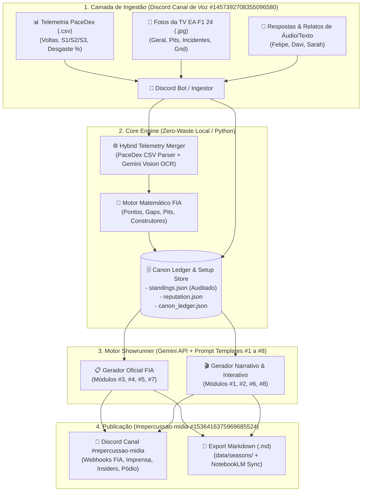
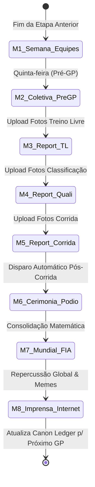
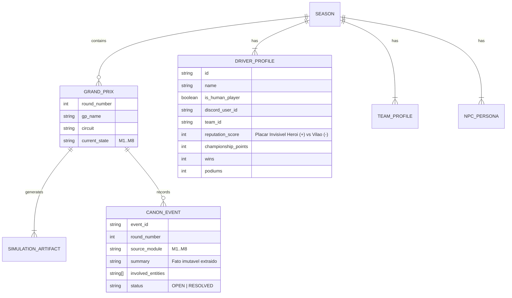

# SAD — Software Architecture Document: Motor de Simulação F1 24 (Showrunner & FIA Engine)

> **Status:** Draft Vivo (v0.1.0) | **Data:** 2026-10-29  
> **Governança:** [orchestrator.md](file:///c:/Users/tricm/.gemini/antigravity-ide/scratch/f1-simulator/orchestrator.md) — Marcus V. Silveira (*Principal Software Architect*)  
> **Jogadores Alvo:** Felipe, Davi e Sarah (*EA Sports F1 24 Multiplayer*)  
> **Referência Base de Prompt:** [prompt_base_gemini_notebook.txt](file:///c:/Users/tricm/Downloads/prompt_base_gemini_notebook.txt)

---

## 1. Visão Executiva e Problema Técnico

O projeto **F1 Simulator** orquestra uma temporada imersiva de RPG (estilo *Drive to Survive*) acoplada às corridas multiplayer do **EA Sports F1 24** disputadas por **Felipe, Davi e Sarah**.

### 1.1. Gargalos do Processo Manual Legado (AS-IS)
1. **Fricção de I/O Humano:** Captura de fotos da tela $\rightarrow$ envio no Discord $\rightarrow$ download manual $\rightarrow$ upload manual no Google NotebookLM $\rightarrow$ disparo manual de 8 prompts sequenciais por etapa.
2. **Deriva Matemática e Alucinação de Estado:** LLMs puros erram somas aritméticas de pontuação do campeonato (Pilotos e Construtores) e perdem o estado fino do placar invisível (*Herói vs. Vilão*) ao longo de 24 etapas.
3. **Colisão de Contexto (RAG vs. Cronologia):** Como todas as simulações dependem dos fatos gerados nas simulações anteriores, o acúmulo de até 192 documentos por temporada ($24 \text{ etapas} \times 8 \text{ módulos}$) causa perda de causalidade temporal na busca vetorial tradicional.
4. **Centralização Single-Player de Interface:** O NotebookLM restringe a interação a uma única tela/conta, impedindo que Felipe, Davi e Sarah respondam às coletivas e dilemas diretamente de seus dispositivos no Discord.

---

## 2. Arquitetura Alvo (TO-BE) e Pilares Zero-Waste

A solução separa estritamente a **Extração/Matemática Determinística** da **Geração Narrativa/Roleplay**, utilizando o Discord como barramento de eventos e interface multiplayer, e um **Canon Ledger** local como fonte única da verdade (*Single Source of Truth*).



> [!IMPORTANT]
> **Regra de Ouro da Continuidade Causal (*Event Sourcing Narrativo*):**
> Ao término de cada um dos 8 módulos de simulação, um pós-processador extrai os **Fatos Canônicos Imutáveis** gerados naquela cena (ex: promessas feitas na coletiva, multas, fofocas de contratos, atritos de pista) e os anexa cronologicamente ao **Canon Ledger**. Nenhuma simulação subsequente roda sem carregar:
> 1. O **Setup Base** (equipes, pilotos, chefes, empresários, imprensa);
> 2. Os **Documentos Integrais** da etapa corrente;
> 3. O **Canon Ledger** consolidado de todas as etapas anteriores.

---

## 3. Máquina de Estados da Etapa (Os 8 Módulos de Simulação)

Cada Grande Prêmio percorre sequencialmente uma máquina de estados de 8 estágios:



### 3.1. Catálogo de Módulos, Contratos e Refinamentos de Prompt

| ID | Módulo de Simulação | Tipo de Execução | Entrada Principal (Inputs) | Saída e Melhorias Arquiteturais |
| :--- | :--- | :--- | :--- | :--- |
| **#1** | **Semana das Equipes** (*Blog "A F1 que você não vê"*) | *Batch / Single-Shot* (por equipe ou grid) | • Setup das Equipes<br>• Resultados e Repercussão (#5 e #8) do GP anterior<br>• Sorteio prévio via código (RNG) de 1–2 temas/dia (Seg–Qui) | Post estruturado com Insider, Dia, Local, Fato, Comentário do Insider, Resumo da Semana e Comentários de Internautas. **Melhoria:** Sorteio de temas feito no código para eliminar viés de repetição do LLM. |
| **#2** | **Coletiva FIA Pré-Etapa** | *Multi-Turno Interativo* (`[Pergunta X de Y]`) | • Fofocas geradas no Módulo #1<br>• Última corrida + Rivalidades ativas<br>• Escalamento de 4–6 pilotos (incl. Felipe, Davi ou Sarah) | Thread interativa no Discord com **Trava de Turno**. O Bot menciona `@Jogador` e aguarda a mensagem de resposta no Discord antes de avançar para `X+1`. Ao final (`Y de Y`), gera transcrição `.md` e atualiza o *Canon Ledger*. |
| **#3** | **Report FIA: Treino Livre** | *Orientado a Visão + Dados* | • Fotos da tela do TL no Discord<br>• Contexto da pista e clima | Extração via Gemini Vision para JSON + Documento FIA contendo Tabela Oficial de Tempos, programas de pneus (*Soft/Medium/Hard*), *sandbagging* e investigações de *track limits*. |
| **#4** | **Report FIA: Classificação (Quali)** | *Orientado a Visão + Dados* | • Fotos da tela do Quali no Discord<br>• Punições pendentes do TL | Dois documentos técnicos no mesmo pacote: **1) *Qualifying Classification*** (tempos puros e gaps) e **2) *Final Starting Grid*** (aplicando punições de grid) + notas de telemetria da Pole Position. |
| **#5** | **Report FIA: Corrida** | *Orientado a Visão + Dados* | • Fotos do resultado final, voltas rápidas e incidentes no Discord | Pacote Oficial FIA: **1) *Final Race Classification***; **2) *Stewards' Decisions*** (`Document Nº X` detalhando infrações e vereditos); **3) *Race Control Summary*** (Safety Cars, DNFs, estratégias). |
| **#6** | **Cerimônia do Pódio & Bastidores** | *Híbrido / Cinematográfico* (4 Atos) | • Resultado Oficial (#5)<br>• Histórico de rivalidades e ordens de equipe | Estruturado em 4 Atos distintos para não colidir com o #8:<br>• **Ato 1:** *Parc Fermé* (entrevistas de pista Top 3)<br>• **Ato 2:** *Cooldown Room* (áudio ambiente diante do telão)<br>• **Ato 3:** *Pódio* (hinos, troféus e chefes)<br>• **Ato 4:** *TV Pen / Zona Mista & Motorhomes* (4º ao 20º, incluindo jogadores fora do pódio, reuniões tensas com empresários). |
| **#7** | **Report FIA: Mundial de Pilotos e Construtores** | *Determinístico (Código) + Formatação* | • JSON da Corrida (#5)<br>• Estado anterior do Campeonato | **Zero cálculo via LLM:** O motor local em código soma pontos (25-18-15-12-10-8-6-4-2-1 + 1 ponto de Volta Mais Rápida se Top 10), aplica critérios de desempate da FIA, atualiza vitórias/pódios/deltas de Construtores e injeta a tabela exata no template oficial da FIA. |
| **#8** | **Imprensa (BR e Intl) & Repercussão na Internet** | *Multi-Formato / Single-Shot* | • Pacote completo do GP (#1 a #7)<br>• Placar *Herói vs. Vilão* atualizado | Estruturado em 4 Blocos Exclusivos de Mídia:<br>• **Bloco 1:** Imprensa Internacional (TV/Jornais europeus)<br>• **Bloco 2:** Imprensa Brasileira (Debate de TV/Rádio focado em Felipe, Davi e Sarah)<br>• **Bloco 3:** YouTube & Podcasts (Cortes e teorias)<br>• **Bloco 4:** Termômetro da Internet (Threads de X/Twitter, Reddit `r/formula1`, memes no Instagram). |

---

## 4. Modelo de Dados e Persistência Local (Contratos Herméticos)

Para garantir reprodutibilidade e independência do NotebookLM web, o repositório manterá uma estrutura de dados versionada em disco:



### 4.1. Estrutura de Diretórios Prevista no Projeto
```text
f1-simulator/
├── orchestrator.md                 # Governança técnica e regras do agente
├── docs/
│   └── SAD.md                      # Este Documento de Arquitetura (Vivo)
├── data/
│   ├── setup/                      # 12 arquivos Mestre/Setup convertidos em Markdown (.md)
│   ├── state/                      # Estado determinístico (standings.json, reputation.json, canon_ledger.json)
│   └── seasons/
│       └── season_01/              # 93 arquivos históricos higienizados (et_01_bahrein a et_10_espanha)
├── prompts/                        # Templates parametrizados dos Módulos #1 a #8 + System Prompt Base
└── src/                            # Motor de Automação (Discord Bot, Gemini Vision OCR, FIA Calculator, Showrunner)
```

### 4.2. Auditoria Empírica do Export do NotebookLM (Etapas 1 a 10)
A extração de **106 documentos** do caderno `F1 - Temporada #01 - 2026` comprovou empiricamente a necessidade da arquitetura proposta:

| Anomalia Detectada nas Fontes Atuais | Evidência Empírica ([00_INDEX_CANON_TEMPORADA_2026.md](file:///c:/Users/tricm/.gemini/antigravity-ide/scratch/f1-simulator/data/setup/00_INDEX_CANON_TEMPORADA_2026.md)) | Solução no Motor TO-BE |
| :--- | :--- | :--- |
| **Divergência Aritmética Pilotos vs. Construtores** | • **Red Bull:** Verstappen ($94$) + Pérez ($39$) = **$133\text{ pts}$**, mas nos Construtores consta **$123\text{ pts}$**.<br>• **Ferrari:** Leclerc ($83$) + Sainz ($15$) = **$98\text{ pts}$**, mas nos Construtores consta **$107\text{ pts}$**.<br>• **Williams:** Davi ($66$) + Albon ($0$) = **$66\text{ pts}$**, mas no Canon consta **$62\text{ pts}$**.<br>• **Aston Martin:** Alonso ($104$) + Stroll ($1$) = **$105\text{ pts}$**, mas nos Construtores consta **$108\text{ pts}$**.<br>• **Sauber:** Felipe ($131$) + Bottas ($0$) = **$131\text{ pts}$**, mas nos Construtores consta **$132\text{ pts}$**. | O módulo `fia_calculator` recalculará toda a tabela a partir dos resultados oficiais de cada corrida ($P_1..P_{10} + VR$), garantindo invariante matemática $\sum \text{Pilotos da Equipe} \equiv \text{Pontos do Construtor}$. |
| **Deriva de Identificadores (Numeração de Carros)** | • **Sarah (Mercedes):** Definida como `#24` no [Setup](file:///c:/Users/tricm/.gemini/antigravity-ide/scratch/f1-simulator/data/setup/Setup%20-%20Perfil%20Sarah.md), mas aparece como `#21` no [Relatório FIA da Etapa 9](file:///c:/Users/tricm/.gemini/antigravity-ide/scratch/f1-simulator/data/seasons/season_01/et_09_canada/Etapa%209%20-%2020261012%20-%20Relat%C3%B3rio%20Oficial%20FIA%20-%20Resultado%20Final%20-%20GP%20do%20Canad%C3%A1%202026.md).<br>• **Verstappen (Red Bull):** Definido como `#1` no [Setup](file:///c:/Users/tricm/.gemini/antigravity-ide/scratch/f1-simulator/data/setup/Setup%20-%20perfil_pilotos.md), mas oscila para `#33` na Etapa 9. | Registro imutável de entidades em `data/state/grid_registry.json`, injetado em todos os relatórios FIA. |
| **Corrupção de Glifos PDF (PUA Unicode)** | Relatórios exportados em PDF continham caracteres privados (`\ue081`, `\ue082`, `\ue092`) no lugar de `(`, `)`, `:`, `+`. | Sanitização UTF-8 aplicada na ingestão e geração nativa em Markdown limpo. |

### 4.3. Fusão de Telemetria: PaceDex CSV + Fotos da TV (EA F1 24)
A inspeção dos arquivos reais da **Etapa 10 (GP da Espanha — Catalunya)** revelou uma complementaridade perfeita entre o exportador UDP (**PaceDex**) e as **Fotos das 4 Abas do Diretor de Prova** na TV:

| Fonte de Dados | Arquivos / Telas | Dados Exclusivos Fornecidos |
| :--- | :--- | :--- |
| **PaceDex CSV (Resumo)** | `pacedex_<gp>_<data>[_TL].csv` | Posição final, Nº do carro, Piloto, Equipe, Total de Voltas, Melhor Volta exata, Total de Pits e Pneu Final (`S`, `M`, `H`). |
| **PaceDex CSV (Volta a Volta)** | `pacedex_<gp>_<data>_laps[_TL].csv` | Telemetria fina de cada volta ($1..N$): Posição na volta, Tempo da volta, Setores `S1`, `S2`, `S3`, Composto atual, Idade do pneu, **Desgaste real (`%`)** e volta exata de entrada no box. |
| **Fotos da TV — Aba 1: `RESULTADOS (GERAL)`** | 2 fotos (Pos 1–14 e Pos 7–20) | **Grid de Largada (`GRID`)**, **Tempo Total de Prova**, **Gaps na bandeirada (`+6.244`)**, Status (`NC`) e Destaque Roxo de Volta Mais Rápida. |
| **Fotos da TV — Aba 2: `PILOTOS`** | 2 fotos (Pos 1–14 e Pos 7–20) | Sequência visual completa de todos os compostos usados na prova (`S ➔ M`, `M ➔ S`, `S ➔ H`). |
| **Fotos da TV — Aba 3: `PARADAS NOS BOXES`** | 2 fotos (Lista de Pits) | **Tempo exato de Pit Stop parado (`2.434s`)**, volta da parada e existência de reparos estruturais. |
| **Fotos da TV — Aba 4: `INCIDENTES`** | 1 foto (Boletim de Comissários) | **Lista oficial de incidentes e punições da FIA** (ex: `Volta 2 | DaviMSSon | Colisão com VERSTAPPEN | Aviso`; `Volta 8 | Lance Stroll | Falha mecânica | NC`). |

### 4.4. Topologia do Servidor Discord (`Guild ID: 1457392707604578460`)
1. **Canal de Voz & Ingestão (`ID: 1457392708355096580`):**
   * Onde Felipe, Davi e Sarah ficam em call durante as sessões online e enviam no chat integrado as **fotos da TV** e os **arquivos `.csv` do PaceDex** (além de breves relatos de áudio/texto pós-corrida).
   * O Bot monitora este canal passivamente para baixar anexos `.csv` e `.jpg`/`.png` da etapa atual.
2. **Canal de Texto `#repercussao-midia` (`ID: 1536416375969685524`):**
   * Canal oficial de publicação dos **8 Módulos da Etapa** (Relatórios da FIA, Cerimônia de Pódio, Coletiva Pré-GP, Blog *"A F1 que você não vê"* e Programas da Imprensa/Internet).

---

## 5. Requisitos Não-Funcionais (NFRs) & Design Orientado à Falha

1. **Idempotência na Ingestão de Fotos e CSVs:** Reenviar a mesma foto ou CSV no Discord não pode duplicar a soma de pontos no campeonato (`round_number` + `session_type` funcionam como chave de idempotência, exigindo flag explícita de `reprocess` para sobrescrever).
2. **Prioridade Determinística CSV > OCR:** Sempre que um dado existir simultaneamente no CSV do PaceDex e na foto da TV (ex: tempo da melhor volta, número de voltas), o **CSV do PaceDex tem precedência absoluta** (zero erro de OCR), cabendo ao Gemini Vision extrair apenas os campos exclusivos das telas da TV (`Grid`, `Tempo Total / Gap`, `Tempo de Pit Stop` e `Incidentes/Punições`).
3. **Tolerância a Limites do Discord:** Textos longos (acima de 2.000 caracteres nas mensagens normais ou 4.096 em Embeds) devem sofrer *chunking* semântico automático por parágrafo/ato, além de anexar o documento `.md` ou `.pdf` completo para leitura confortável.
4. **Resiliência de API:** Chamadas à API do Gemini devem implementar *exponential backoff* com *jitter* e validação de schema JSON via Pydantic/Zod.

---

## 6. Roadmap de Descoberta e Próximos Passos (Backlog Arquitetural)

- [x] **Passo 1:** Assimilação das diretrizes do [orchestrator.md](file:///c:/Users/tricm/.gemini/antigravity-ide/scratch/f1-simulator/orchestrator.md).
- [x] **Passo 2:** Diagnóstico do Prompt Base ([prompt_base_gemini_notebook.txt](file:///c:/Users/tricm/Downloads/prompt_base_gemini_notebook.txt)) e mapeamento dos 8 Módulos de Simulação.
- [x] **Passo 3:** Formalização do SAD v0.1.0 ([docs/SAD.md](file:///c:/Users/tricm/.gemini/antigravity-ide/scratch/f1-simulator/docs/SAD.md)).
- [x] **Passo 4:** Extração, sanitização e organização das 106 fontes do NotebookLM em `data/setup/` (12 arquivos) e `data/seasons/season_01/` (93 arquivos, Etapas 1 a 10).
- [x] **Passo 5a:** Reconciliação da pontuação oficial das Etapas 1 a 9 ([auditoria_etapas_01_a_09.md](file:///c:/Users/tricm/.gemini/antigravity-ide/scratch/f1-simulator/data/state/auditoria_etapas_01_a_09.md) e [standings.json](file:///c:/Users/tricm/.gemini/antigravity-ide/scratch/f1-simulator/data/state/standings.json)) com oficialização da dedução de $-10\text{ pts}$ de Construtores à Red Bull Racing pelo incidente do Túnel de Mônaco.
- [x] **Passo 5b:** Inspeção dos arquivos CSV do PaceDex e das 7 fotos da tela do *EA F1 24* da Etapa 10 (Espanha) + mapeamento dos 2 canais do Discord.
- [x] **Passo 6:** Aprovação do Plano de Implementação (`/plan`) e construção do Motor de Automação + Geração completa da Etapa 10 (GP da Espanha — Módulos #3 a #8).

