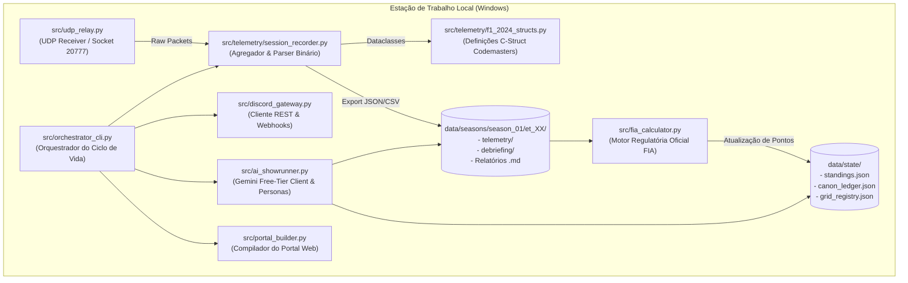
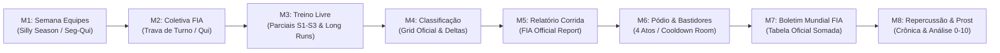
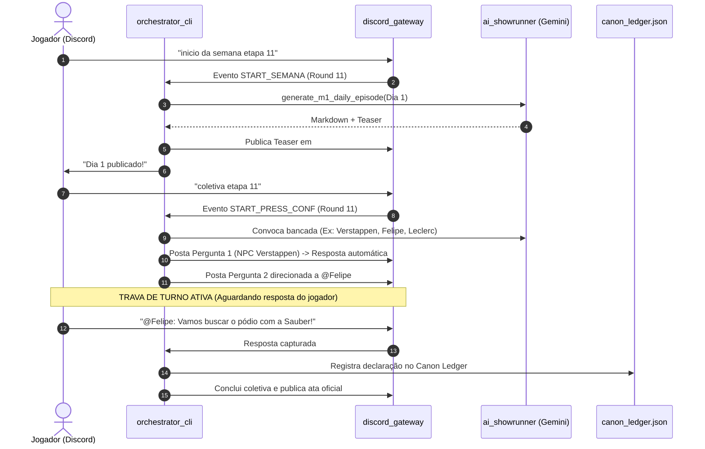
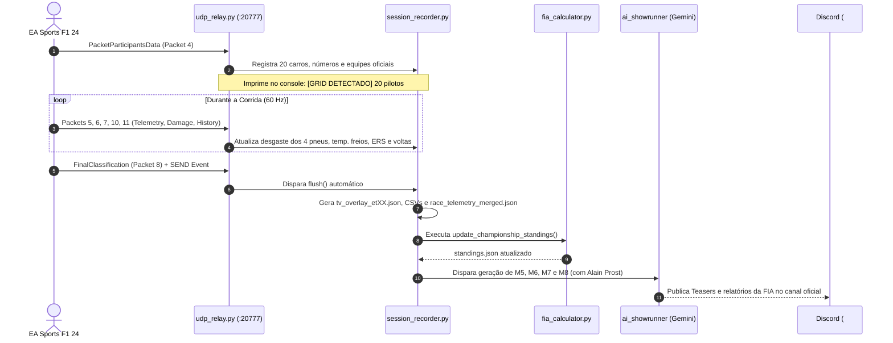

# SAD — Software Architecture Document: Motor de Simulação F1 2026 (Showrunner & FIA Engine)
**Padrão de Especificação:** arc42 (IEEE 42010 / ISO/IEC/IEEE 42020)  
**Versão do Documento:** v2.0.0 (Solução 100% Local & Telemetria UDP Nativa)  
**Data:** 05/11/2026  
**Governança & Autoria:** Especialista em Arquitetura & Especificação Funcional/Técnica de TI  
**Stakeholders & Pilotos Reais:** Felipe (frdsilva / Sauber #5), Davi (DaviMSSon / Williams #15) e Sarah (SarahMarinsS / Mercedes #24)  
**Ambiente de Execução:** Máquina Local (Windows 11 / Python 3.12+ / F1 24 UDP / Discord REST v10)  

---

## 1. Introdução e Metas do Sistema

### 1.1. Propósito e Metas de Negócio
O **F1 Simulator Showrunner** é uma plataforma local de automação esportiva e orquestração narrativa de RPG (estilo *Drive to Survive* e cobertura televisiva da Fórmula 1) acoplada diretamente ao simulador **EA Sports F1 24**.

O sistema possui duas metas funcionais centrais:
1. **Auditoria Regulatória Oficial da FIA (Determinística):** Capturar em tempo real a telemetria do simulador, registrar cronometragem milimétrica de voltas e setores (S1, S2, S3), calcular pontuação do campeonato mundial segundo o regulamento desportivo internacional da FIA e garantir conformidade aritmética absoluta ($\sum \text{Pilotos} \equiv \text{Construtor}$).
2. **Imersão Narrativa e Storytelling Multi-Persona (Generativa):** Transformar incidentes de pista, telemetria de componentes mecânicos e escolhas táticas em crônicas jornalísticas, coletivas interativas com os pilotos reais, bastidores de motorhome e análises de pilotagem conduzidas pela persona de **Alain Prost ("Le Professeur")**.

### 1.2. Stakeholders & Matriz de Responsabilidades
| Stakeholder | Perfil / Papel | Necessidade Primária | Interface no Sistema |
| :--- | :--- | :--- | :--- |
| **Felipe (`frdsilva`)** | Piloto Titular (Sauber #5) & Decisor | Simulação estável, zero atrito operacional, liderança sênior da equipe. | Discord `#geral` + Simulador F1 24 |
| **Davi (`DaviMSSon`)** | Piloto Titular (Williams #15) | Disputas de pista, respostas dinâmicas em coletivas, evolução de rivalidade. | Discord `#geral` + Simulador F1 24 |
| **Sarah (`SarahMarinsS`)** | Piloto Titular (Mercedes #24) | Telemetria precisa, consistência tática e narrativa de alta performance. | Discord `#geral` + Simulador F1 24 |
| **Direção de Prova FIA** | Entidade Reguladora (M5, M7) | Classificação final auditada, penalidades aplicadas sem erro de transcrição. | Artefatos `.md` + Portal Mobile |
| **Paddock & Imprensa** | Personas Jornalísticas (M1, M2, M6, M8) | Cobertura dramática crível, embasada em dados mecânicos e telemetria fina. | Webhooks `#repercussao-midia` |

### 1.3. Metas de Qualidade (ISO/IEC 25010)
* **QG-01 (Acurácia Numérica):** Tolerância zero para alucinações de pontuação, posições ou tempos de volta.
* **QG-02 (Zero-Waste / Baixa Fricção):** Eliminação de digitação manual de relatórios e de captura de fotos da TV.
* **QG-03 (Isolamento e Segurança Local):** Execução 100% contida na estação local, sem dependência de bancos de dados pagos em nuvem ou servidores externos dedicados.
* **QG-04 (Causalidade Temporal):** Continuidade estrita do Canon de uma etapa para a seguinte via *Event Sourcing Narrativo*.

---

## 2. Restrições Arquiteturais

| ID | Restrição | Justificativa Técnica & Limite Operacional |
| :--- | :--- | :--- |
| **CON-01** | **Ambiente 100% Local** | A solução deve rodar integralmente na estação de trabalho do usuário (Windows), sem microserviços em nuvem (GCP, AWS) ou instâncias pagas de backend. |
| **CON-02** | **Custo Operacional Zero (R$ 0,00)** | A camada generativa deve operar nos limites de *Free Tier* do Google AI Studio (Gemini 2.5/3.5 Flash e Flash-Lite). |
| **CON-03** | **Socket UDP Exclusivo (20777)** | A captura da telemetria ocorre via datagramas UDP broadcast/unicast na porta `20777`, eliminando middlewares e proxies intermediários (como PaceDex). |
| **CON-04** | **Contrato Discord REST v10** | Interação multiplayer via canais de voz/texto da guilda `1457392707604578460` através de bot token e webhooks oficiais. |
| **CON-05** | **Imutabilidade de Arquivos Legados** | As etapas concluídas (`data/seasons/season_01/et_01` a `et_10`) e a tabela histórica canônica não podem sofrer regressão acidental durante os testes. |

---

## 3. Contexto e Escopo do Sistema

### 3.1. Contexto de Negócio
```
┌─────────────────────────────────┐                    ┌───────────────────────────────────┐
│       EA Sports F1 24           │                    │         Discord Community         │
│  (Simulador Multiplayer / LAN)  │                    │   (#geral & #repercussao-midia)   │
└────────────────┬────────────────┘                    └─────────────────▲─────────────────┘
                 │ Datagramas UDP 60Hz                                   │ REST v10 / Webhooks
                 ▼                                                       │
   ┌─────────────────────────────────────────────────────────────────────┴─────────────────┐
   │                               SHOWRUNNER LOCAL ENGINE                                 │
   │                                                                                       │
   │   [Receptor UDP] ➔ [Agregador de Sessão] ➔ [Calculador FIA] ➔ [Motor Multi-Persona]   │
   └─────────────────────────────────────────┬─────────────────────────────────────────────┘
                                             │ Deploy Local
                                             ▼
                               ┌───────────────────────────┐
                               │   Portal Editorial Web    │
                               │     (GitHub Pages)        │
                               └───────────────────────────┘
```

### 3.2. Interfaces Técnicas Externas
1. **IF-UDP-01 (EA Sports F1 24 Telemetry Feed):**
   * Protocolo: UDP Socket Unicast / Broadcast.
   * Porta Padrão: `20777`.
   * Formato: Codemasters F1 2024 Packet Specification (Header de 29 bytes + payloads específicos por Packet ID).
2. **IF-DISCORD-01 (Gateway de Ingestão & Comandos):**
   * Canal: `#geral` (Voice Text Chat ID `1457392708355096580`).
   * Protocolo: HTTPS REST v10 via Polling com backoff adaptativo.
3. **IF-DISCORD-02 (Canal de Publicação Editorial):**
   * Canal: `#repercussao-midia` (Text Chat ID `1536416375969685524`).
   * Protocolo: Webhook multipart/form-data com suporte a embeds, teasers e renderização de tabelas PNG.
4. **IF-GEMINI-01 (Camada Cognitiva & Roleplay):**
   * Endpoint: Google AI Studio API (`v1beta/models`).
   * Modelos Alvo: `gemini-flash-lite-latest` / `gemini-2.5-flash`.

---

## 4. Estratégia de Solução

### 4.1. Arquitetura Hexagonal & Separação de Preocupações (SoC)
A solução adota o paradigma de **Arquitetura Hexagonal (Ports & Adapters)** para blindar o domínio esportivo e regulamentar da FIA de variações de rede ou alucinações de LLM:

```
[ Jogo F1 24 ] ──► (Porta UDP Inbound)  ──┐
                                          ▼
[ Discord ]    ──► (Porta Chat Inbound) ──►  [ NÚCLEO DETERMINÍSTICO ]
                                             • fia_calculator.py
                                             • session_recorder.py
                                             • standings.json
                                          ▲
[ Gemini SDK ] ◄── (Porta IA Generativa) ──┤
                                          ▼
[ Discord ]    ◄── (Porta Outbound)     ──┴──► [ ARTEFATOS CANÔNICOS ]
[ Web Portal ] ◄── (Porta Static Web)          • RELATORIO_FIA.md
                                               • race_telemetry_merged.json
```

### 4.2. Desacoplamento de Dependências Externas (Depreciação PaceDex & OCR)
* **Problema Legado:** Dependência do aplicativo PaceDex gravando CSVs na máquina e necessidade de fotos de TV submetidas a Vision OCR.
* **Solução Implementada:** Desempacotamento binário nativo dos pacotes UDP 5, 6, 7, 8, 10 e 11 diretamente no Python. Os dados de classificação, tempos de setor, desgaste de pneus e incidentes fluem diretamente da memória para o disco com 100% de precisão matemática.

---

## 5. Visão de Blocos / Componentes (Building Block View)

### 5.1. Nível 2 — Contêineres de Software


### 5.2. Especificação Funcional e Contratos dos 8 Módulos (M1 a M8)



#### Contrato Formal dos Módulos:

| Módulo | Nome & Arquivo de Prompt | Entrada Primária (Inputs Rígidos) | Processamento Local & Invariantes | Saída Oficial (Outputs) |
| :--- | :--- | :--- | :--- | :--- |
| **M1** | **Semana das Equipes**<br>`01_semana_equipes.md` | • `canon_ledger.json`<br>• Resultados do GP anterior<br>• Sorteio RNG de temas de bastidores | Sorteia 4 temas por equipe (Seg a Qui); consome pendências e rivalidades abertas. | Dossiê de paddock publicado no Portal e teaser no Discord. |
| **M2** | **Coletiva de Imprensa FIA**<br>`02_coletiva_pre_gp.md` | • Pauta gerada no M1<br>• Tabela do Mundial<br>• Painel de 5–6 pilotos convocados | Protocolo de **Trava de Turno**: pilotos humanos (Felipe, Davi, Sarah) respondem antes do avanço. | Ata oficial transcrita da coletiva + Atualização do Canon Ledger. |
| **M3** | **Relatório FIA: Treino Livre**<br>`03_fia_treino_livre.md` | • Telemetria UDP de Treino Livre (Packets 2, 6, 11) | Extração de melhores tempos por setor (S1, S2, S3), velocidade final e ritmo de pneus. | Documento Técnico Oficial FIA de Treino Livre. |
| **M4** | **Classificação & Grid de Largada**<br>`04_fia_classificacao.md` | • `PacketFinalClassificationData` de Qualy<br>• Histórico de punições de grid | Montagem determinística das posições P1 a P20 e deltas para a pole position. | Documento Oficial de Grid de Largada da FIA. |
| **M5** | **Relatório da Corrida (FIA)**<br>`05_fia_corrida.md` | • `tv_overlay_etXX.json`<br>• `pacedex_udp_race_laps.csv`<br>• `race_telemetry_merged.json` | Auditoria completa de voltas, paradas de box, compostos utilizados e punições dos comissários. | Relatório Oficial FIA pós-corrida (Resultado Final). |
| **M6** | **Pódio & Cooldown Room**<br>`06_cerimonia_podio.md` | • Resultado oficial (M5)<br>• Deltas de chegada ($+0.021\text{s}$)<br>• Danos físicos e telemetria de freios | Geração cinematográfica em 4 Atos (*Parc Fermé*, *Cooldown Room*, *Pódio*, *Zona Mista*). | Crônica de bastidores focada nos 3 pilotos brasileiros e rivais diretos. |
| **M7** | **Boletim Mundial de Pilotos & Construtores**<br>`07_fia_mundial.md` | • `standings.json`<br>• Resultado auditado M5 | **Cálculo 100% determinístico (`fia_calculator.py`):** Aplicação de pontuação FIA e critério de volta rápida. | Tabela atualizada do campeonato + Boletim oficial FIA. |
| **M8** | **Repercussão da Mídia & Análise Técnica**<br>`08_repercussao_midia.md` | • Telemetria Packets 5, 6, 7, 10<br>• Notas e vereditos de **Alain Prost**<br>• Pacote completo da etapa | Análise tática fundamentada em dados de condução (pneus, freios, ERS) + Reportagens de imprensa internacional. | Cobertura jornalística global, debate esportivo e avaliação de notas 0 a 10. |

---

## 6. Visão de Execução (Runtime View)

### Cenário 1: Ciclo Semanal Pré-Pista (M1 & M2)


### Cenário 2: Captura de Pista UDP em Tempo Real (M3 a M8)


---

## 7. Visão de Implantação e Topologia Local

```
C:\Users\tricm\.gemini\antigravity-ide\scratch\f1-simulator\
├── .env                                  # Segredos locais (DISCORD_BOT_TOKEN, GEMINI_API_KEY)
├── orchestrator.md                       # Governança de regras do Agente
├── docs/
│   └── SAD.md                            # Esta especificação de arquitetura (arc42)
├── data/
│   ├── setup/                            # Enciclopédia canônica (Perfis dos pilotos e equipes)
│   ├── state/                            # Estado imutável e auditado
│   │   ├── standings.json                # Classificação oficial do campeonato
│   │   ├── canon_ledger.json             # Histórico de fatos e escândalos narrativos
│   │   └── grid_registry.json            # Identificadores canônicos de carros e pilotos
│   ├── seasons/
│   │   └── season_01/                    # Repositório de etapas da temporada 2026
│   │       ├── et_01_bahrein/ ... et_10_espanha/
│   │       └── et_11_austria/            # Diretório da etapa corrente
│   │           ├── telemetry/            # JSONs canônicos e CSVs capturados via UDP
│   │           └── *.md                  # Os 8 módulos gerados
│   └── telemetry_pilot_test/             # Sandbox isolado para testes pilotos (Portimão)
├── prompts/                              # Templates parametrizados dos Módulos M1 a M8
└── src/                                  # Código-fonte da aplicação local
    ├── udp_relay.py                      # Listener UDP de alto desempenho (Porta 20777)
    ├── fia_calculator.py                 # Motor matemático e regulamentar da FIA
    ├── ai_showrunner.py                  # Cliente Gemini e gerador multi-persona
    ├── discord_gateway.py                # Integração com API REST e Webhooks do Discord
    ├── telemetry/                        # Parsers de estruturas C binárias do F1 24
    └── personas/                         # Definição comportamental de personas (Alain Prost, etc.)
```

---

## 8. Conceitos Transversais e Invariantes

### 8.1. Invariantes Matemáticas da FIA
1. **Conservação da Pontuação de Construtores:**  
   $$\text{Pontos}_{\text{Construtor}} = \sum \text{Pontos}_{\text{Piloto}_1} + \text{Pontos}_{\text{Piloto}_2} + \text{Bônus}_{\text{Volta Rápida}} - \text{Penalidades Administrativas}$$
2. **Volta Mais Rápida:**  
   O ponto extra de volta mais rápida só é creditado se o piloto concluir a corrida entre os 10 primeiros colocados ($P \le 10$).
3. **Desempate Regulamentar:**  
   Em caso de empate em pontos, o desempate segue rigorosamente: maior número de vitórias ($P_1$), maior número de segundos lugares ($P_2$), e assim sucessivamente.

### 8.2. Esquema do Contrato Canônico de Telemetria (`race_telemetry_merged.json`)
```json
{
  "round": 11,
  "grand_prix": "GP da Áustria (Spielberg)",
  "source": "F1_2024_UDP_LIVE_FEED",
  "race_results": [
    {
      "pos": 1,
      "driver_number": 33,
      "driver_name": "Max Verstappen",
      "team": "Red Bull Racing",
      "grid": 1,
      "best_lap": "1:07.412",
      "total_time_or_gap": "1:15:32.104",
      "points": 25,
      "status": "FINISHED",
      "strategy": "S ➔ M",
      "max_wear_pct": 28.4,
      "max_brake_temp_c": 742,
      "max_tyre_inner_temp_c": 104,
      "ers_pct": 42.1,
      "pu_ice_wear": 4.2,
      "warnings": 1,
      "penalties_s": 0
    }
  ],
  "incidents": [],
  "driver_ratings": {}
}
```

---

## 9. Registro de Decisões Arquiteturais (ADRs)

* **ADR-001 (Solução 100% Local):** Rejeitada infraestrutura remota (Cloud Run / Firestore) em favor de persistência JSON local e execução na máquina de simulação, reduzindo custo a R$ 0,00 e latência a zero.
* **ADR-002 (Ingestão Nativa UDP 20777):** Descontinuado o uso de fotos manuais de TV e do software PaceDex. O sistema processa nativamente os pacotes 5, 6, 7, 8, 10 e 11 do fluxo binário da Codemasters.
* **ADR-003 (Separação Rígida Determinística vs. LLM):** A pontuação, tabelas de setores e gaps são calculados por algoritmos em Python; o LLM (Gemini) é restrito à redação, tom de voz e dramatização.
* **ADR-004 (Trava de Turno na Coletiva):** Implementado mecanismo de espera ativa assíncrona no Discord para permitir que os jogadores reais respondam perguntas antes da continuidade do roteiro.
* **ADR-005 (Crônica Técnica de Alain Prost):** Incorporada a persona de "Le Professeur" para emitir notas de 0 a 10 baseadas em parâmetros reais de pilotagem (gestão de pneus, freios e eficiência de ERS).

---

## 10. Requisitos de Qualidade e Critérios de Aceite

| Requisito | Cenário de Teste / Verificação | Critério de Aceite |
| :--- | :--- | :--- |
| **Integridade de Grid** | Execução de teste unitário `test_grand_prix_local_driver_resolution` | 100% dos 20 carros da IA e jogadores mapeados com nomes e equipes oficiais. |
| **Resiliência a Nulos** | Parser de tempos de volta com strings de DNF, traço (`—`) ou porcentagem | Zero exceções de tipo (`ValueError: could not convert string to float`). |
| **Tolerância a Perda** | Listener UDP operando sob taxa de 60Hz por 70 voltas | Buffer de socket de 4 MB sem descarte de datagramas do sistema operacional. |
| **Isolamento de Teste** | Execução do listener em modo `--test` | Nenhum arquivo criado ou modificado fora de `data/telemetry_pilot_test/`. |

---

## 11. Riscos Técnicos e Débito Mitigado

1. **Risco: Modificação Acidental do Campeonato Oficial durante Testes:**
   * *Mitigação:* Implementação da flag explícita `--test` / `--pilot` no `SessionRecorder`, redirecionando saídas para diretório sandbox estanque.
2. **Risco: Rate Limit do Free Tier do Google AI Studio (15 RPM / 1M TPM):**
   * *Mitigação:* Implementação de *pacing* de chamadas no `ai_showrunner.py` (espera de 32 segundos entre chamadas Pro e chaveamento para modelos Flash-Lite quando em lote).
3. **Risco: Queda de Conexão durante Coletiva Interativa no Discord:**
   * *Mitigação:* Estado salvo a cada pergunta em `discord_session_state.json`, permitindo retomada imediata do ponto exato da interrupção.

---

## 12. Glossário & Linguagem Ubíqua (Domain-Driven Design)

* **Canon Ledger:** Livro-razão em arquivo JSON imutável que registra fatos históricos, promessas, multas e rivalidades criadas na temporada.
* **Trava de Turno:** Estado da máquina de diálogo do Discord em que o avanço da pauta é bloqueado até que um jogador humano específico envie sua mensagem.
* **Session UID:** Identificador numérico de 64 bits transmitido pelo F1 24 que distingue sessões de treinos, qualificação e corrida.
* **Packet ID:** Identificador Codemasters no cabeçalho UDP indicando a natureza do payload (4: Participantes, 8: Classificação Final, 10: Danos, 11: Histórico de Voltas).
* **Speed Trap:** Ponto da pista de maior velocidade aferida em km/h registrado pelo sensor de telemetria.
