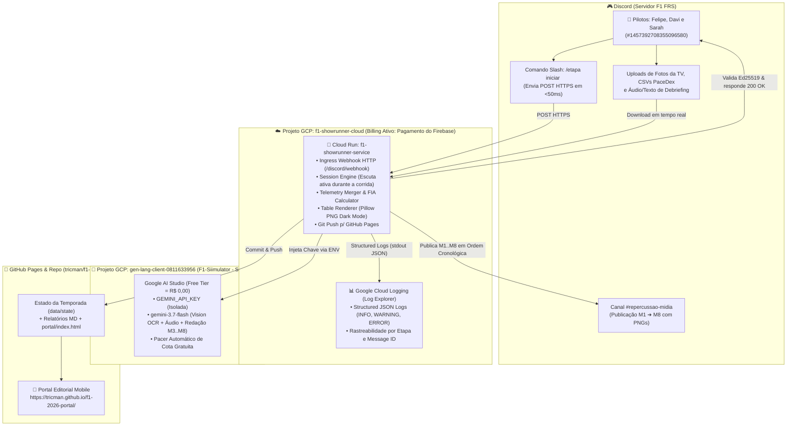

# SAD v2.0 — F1 2026 Showrunner: Arquitetura Cloud-Native Autônoma no GCP (Cloud Run & Log Explorer)

> **Status:** Aprovado para Implementação | **Versão:** 2.0.0  
> **Liderança Técnica:** Marcus V. Silveira (*Principal Software Architect*) & Squad F1 Showrunner  
> **Pilares:** *Scale-to-Zero (Custo Zero em Repouso), Isolamento de Faturamento, Observabilidade em Tempo Real (Log Explorer) e Determinismo Matemático da FIA*

---

## 1. Visão Geral e Decisão Arquitetural

A versão **v2.0** elimina qualquer dependência do **Antigravity-IDE** local e do **GitHub Actions**, unificando toda a orquestração em uma arquitetura serverless no **Google Cloud Platform (GCP)** com container **Cloud Run** acionado via Webhook e observabilidade de ponta a ponta no **Cloud Logging (Log Explorer)**.

### Matriz de Decisões Estratégicas

| Dimensão | Solução Anterior (v1.x / Actions) | Solução Aprovada (SAD v2.0 - GCP Cloud Run) | Motivação & Benefício |
| :--- | :--- | :--- | :--- |
| **Hospedagem & Execução** | GitHub Actions Workflow | **Cloud Run Service (GCP)** | Elimina instabilidades de runners, timeouts de rede e limites de concorrência. |
| **Gatilho de Inicialização** | Schedule / Cron / Polling manual | **Discord Interactions Webhook (`/etapa iniciar <N>`)** | **Scale-to-Zero:** O container permanece **100% desligado (custo zero)** até o piloto acionar o comando. |
| **Janela da Corrida** | Sessão de runner efêmero | **Sessão Ativa com CPU Sempre Alocada durante a Corrida** | Mantém a escuta do canal de voz em tempo real confirmando arquivos e fotos até o comando `final da etapa <N>`. |
| **Observabilidade & Auditoria** | Logs truncados de runner do GitHub | **Google Cloud Logging (Log Explorer)** | Logs estruturados em formato JSON com severidade (`INFO`, `WARNING`, `ERROR`), rastreamento de IDs de mensagens e métricas de latência. |
| **Gestão de Custos & Billing** | Risco de perda de cota gratuita | **Estratégia de Projetos Isolados (2 Projetos GCP)** | Preserva o **Free Tier do Google AI Studio** no projeto de IA e isola o container no projeto de infraestrutura com billing ativo. |

---

## 2. Topologia Multi-Projeto no GCP (Isolamento de Billing & Free Tier)

Para garantir que a chave do Gemini permaneça estritamente no **Nível Gratuito** sem qualquer cobrança por tokens, a infraestrutura divide as responsabilidades entre dois projetos no GCP:



### Detalhamento dos Projetos:
1. **Projeto de Inteligência (`gen-lang-client-0811633956` - `F1-Siimulator`):**
   - **Status:** **Sem conta de faturamento vinculada**.
   - **Recurso:** Gera a `GEMINI_API_KEY` do Google AI Studio com cota 100% gratuita para os modelos `gemini-3.7-flash` e família Flash.
2. **Projeto de Infraestrutura (`f1-showrunner-cloud`):**
   - **Status:** Vinculado à conta de faturamento ativa `0134AD-9E190D-0ADA56` (*Pagamento do Firebase*).
   - **Recursos Ativos:** Cloud Run API, Container Registry / Artifact Registry, Cloud Logging.
   - **FinOps:** Como as corridas acontecem em janelas curtas, o consumo mensal de vCPU e memória do Cloud Run permanece **dentro do Free Tier do Google Cloud** (180.000 vCPU-segundos/mês grátis).

---

## 3. Fluxo Operacional da Sessão (Ciclo de Vida de uma Corrida)

```mermaid
sequenceDiagram
    autonumber
    actor Piloto as Felipe / Davi / Sarah (Discord)
    participant CR as Cloud Run (f1-showrunner-cloud)
    participant Log as GCP Log Explorer
    participant Gemini as Gemini 3.7 Flash (AI Studio)
    participant Engine as Motor FIA & Renderer (Python)
    participant DiscordPub as Discord (#repercussao-midia)

    Piloto->>CR: Slash Command: /etapa iniciar round:10
    CR->>Log: {"severity": "INFO", "event": "SESSION_INIT", "round": 10}
    CR-->>Piloto: 🟢 Sessão Iniciada! Estou escutando este canal.
    
    rect rgb(30, 41, 59)
    Note over Piloto,CR: Janela da Corrida (Sessão Ativa no Cloud Run)
    Piloto->>CR: Upload das 7 Fotos da TV
    CR->>Log: {"severity": "INFO", "event": "PHOTOS_SAVED", "count": 7}
    CR-->>Piloto: 📸 7 fotos arquivadas!
    Piloto->>CR: Upload dos 4 CSVs PaceDex
    CR->>Log: {"severity": "INFO", "event": "CSVS_SAVED", "files": 4}
    CR-->>Piloto: 📊 Telemetrias PaceDex recebidas!
    Piloto->>CR: Áudio/Texto de Debriefing pós-corrida
    CR->>Log: {"severity": "INFO", "event": "DEBRIEF_RECEIVED"}
    CR-->>Piloto: 🎙️ Relato de debriefing registrado!
    end

    Piloto->>CR: Mensagem: "final da etapa 10" (ou /etapa finalizar)
    CR->>Log: {"severity": "INFO", "event": "END_ROUND_TRIGGERED", "round": 10}
    CR-->>Piloto: 🏁 Pacote recebido! Iniciando processamento oficial...

    rect rgb(20, 83, 45)
    Note over CR,Engine: Pipeline Determinístico e IA Multimodal
    CR->>Engine: telemetry_merger.py & fia_calculator.py
    CR->>Log: {"severity": "INFO", "event": "FIA_MATH_COMPLETED"}
    CR->>Gemini: Transcreve debriefings e redige Módulos M3 a M8
    Gemini-->>CR: Relatórios Markdown Estruturados
    CR->>Log: {"severity": "INFO", "event": "AI_MODULES_GENERATED"}
    CR->>Engine: table_renderer.py (Gera PNGs F1 TV) + portal_builder.py
    CR->>Log: {"severity": "INFO", "event": "PNG_TABLES_RENDERED"}
    end

    rect rgb(124, 45, 18)
    Note over CR,DiscordPub: Publicação e Encerramento
    CR->>Engine: Git Push para GitHub Pages (tricman.github.io/f1-2026-portal)
    CR->>DiscordPub: Publica M1..M8 em Ordem Cronológica + PNGs
    CR->>Log: {"severity": "INFO", "event": "DISCORD_PUBLISHED", "round": 10}
    CR-->>Piloto: ✅ Etapa 10 publicada no Portal e no Discord!
    CR->>Log: {"severity": "INFO", "event": "SESSION_CLOSED_SCALE_TO_ZERO"}
    end
```



---

## 4. Padrão de Observabilidade no Cloud Logging (Log Explorer)

Todas as saídas do container serão emitidas no formato **JSON Estruturado** diretamente no `stdout`/`stderr`. O Google Cloud Logging detecta esse formato nativamente, permitindo buscas e filtros avançados no **Log Explorer**.

### Esquema Padrão do Log Estruturado
```json
{
  "severity": "INFO",
  "message": "Fotos da TV processadas e validadas com sucesso.",
  "service": "f1-showrunner",
  "round": 10,
  "stage": "VISION_OCR",
  "event": "OVERLAY_EXTRACTED",
  "details": {
    "photos_count": 7,
    "drivers_detected": 20,
    "pole_position": "Sarah (#24)"
  },
  "timestamp": "2026-10-31T15:45:00Z"
}
```

### Consultas Rápidas no Log Explorer (Google Cloud Console):
- **Acompanhar uma etapa inteira:**  
  `resource.type="cloud_run_revision" AND jsonPayload.round=10`
- **Filtrar erros ou falhas de APIs:**  
  `resource.type="cloud_run_revision" AND severity>=WARNING`
- **Auditar publicações no Discord:**  
  `jsonPayload.event="DISCORD_PUBLISHED"`

---

## 5. Implementação Técnica do Container Cloud Run

### 5.1. Configuração do Serviço no Cloud Run
- **Nome do Serviço:** `f1-showrunner-service`
- **Região:** `southamerica-east1` (São Paulo) ou `us-central1` (Iowa)
- **Recursos:** `1 vCPU`, `1024 MiB RAM`
- **Alocação de CPU:** `CPU allocated during request processing` com `--no-cpu-throttling` ativo durante a sessão para permitir o loop de escuta.
- **Scale-to-Zero:** `--min-instances=0`, `--max-instances=1` (garante que nunca haverá duas instâncias concorrentes).
- **Timeout Máximo:** Configurado para 3600s (1h) por requisição ou sessão modular.

### 5.2. Variáveis de Ambiente & Secrets no Cloud Run
- `DISCORD_BOT_TOKEN`: Token do bot F1 Showrunner
- `DISCORD_WEBHOOK_URL`: Webhook do canal `#repercussao-midia`
- `DISCORD_GUILD_ID`: `1457392707604578460`
- `DISCORD_VOICE_INGEST_CHANNEL_ID`: `1457392708355096580`
- `DISCORD_MEDIA_PUBLISH_CHANNEL_ID`: `1536416375969685524`
- `GEMINI_API_KEY`: Chave do projeto `F1-Siimulator` (`gen-lang-client-0811633956`)
- `GITHUB_PAT`: Token pessoal do GitHub para *push* dos relatórios e do Portal
- `PORTAL_PUBLIC_URL`: `https://tricman.github.io/f1-2026-portal/`

---

## 6. Plano de Ação para Implementação Imediata

1. **Criação do Projeto GCP e Vinculação de Billing:**
   - Criar o projeto `f1-showrunner-cloud`;
   - Vincular à conta de faturamento `0134AD-9E190D-0ADA56` (*Pagamento do Firebase*);
   - Habilitar as APIs do Cloud Run, Cloud Build e Cloud Logging.
2. **Refatoração dos Logs para JSON Estruturado ([`src/logger.py`](file:///c:/Users/tricm/.gemini/antigravity-ide/scratch/f1-simulator/src/logger.py)):**
   - Criar módulo de logging compatível com Cloud Logging (`severity`, `jsonPayload`).
3. **Endpoint de Interação Discord ([`src/cloud_server.py`](file:///c:/Users/tricm/.gemini/antigravity-ide/scratch/f1-simulator/src/cloud_server.py)):**
   - Implementar verificação de assinatura Ed25519 e receptor do comando `/etapa iniciar`.
4. **Build e Deploy do Container via `gcloud`:**
   - Construir a imagem Docker e fazer o deploy no Cloud Run com scale-to-zero.
5. **Configuração da Interactions Endpoint URL no Discord Developer Portal:**
   - Cadastrar a URL gerada pelo Cloud Run nas configurações do bot.
