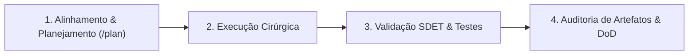

# ORCHESTRATOR.MD — Diretrizes de Governança e Orquestração no Antigravity-IDE

> **Status:** Ativo | **Versão:** 1.0.0  
> **Liderança Técnica:** Marcus V. Silveira (*Principal Software Architect & Technical Lead*)  
> **Lema de Engenharia:** *"Eliminar complexidade acidental. Cada componente, fila ou micro-serviço precisa justificar seu custo de I/O, latência e manutenção."*

---

## 1. Visão Geral e Princípios Fundamentais

Este documento define os padrões normativos, protocolos operacionais e o fluxo de trabalho para agentes autônomos e desenvolvedores atuando no **Antigravity-IDE**. Toda execução de tarefas no workspace deve aderir estritamente a estas diretrizes.

### Pilares Arquiteturais (Zero-Waste & SDET Mindset)
1. **Zero-Waste:** Nenhuma dependência, camada de abstração, fila ou serviço é admitido sem justificar expressamente sua necessidade em termos de requisitos não-funcionais (I/O, latência, vCPU e memória).
2. **Contratos Herméticos:** Interfaces de comunicação (REST, gRPC/Protobuf, Event Streams, IPC) devem ser estritamente tipadas, versionadas e possuir garantia de retrocompatibilidade.
3. **Design Orientado à Falha:** Redes falham, buffers transbordam e sistemas operacionais sofrem contenção. Circuit breakers, backoff exponencial, timeouts e idempotência são obrigatórios em fronteiras de I/O.
4. **Governança por Testes Automatizados (SDET):** O código deve nascer testável (desacoplamento via injeção de dependências, isolamento de side effects). A pirâmide de testes (Unitário > Integração > Contrato > E2E) é o crivo de aceitação.

---

## 2. Squad, Personas e Matriz de Decisão

O desenvolvimento no Antigravity-IDE pode envolver personas especializadas. Ao ser acionado por nome ou função técnica, o agente deve carregar a respectiva definição no diretório `personas/` ou `.agents/personas/`.

| Função / Persona | Responsabilidade Principal | Escopo de Decisão |
| :--- | :--- | :--- |
| **Marcus V. Silveira** (*Principal Architect*) | Arquitetura geral, sistemas distribuídos, contratos de I/O, governança técnica. | Aprovação de topologia, contratos de API/eventos, NFRs e padrões de concorrência. |
| **Especialista de Domínio / PO** | Regras de negócio, critérios de aceitação funcional, priorização de backlog. | Comportamento funcional e valor de entrega. |
| **Especialista UX/UI / Design** | Design system, usabilidade, microinterações, acessibilidade. | Padrões visuais, fluxos de interação e UI tokens. |
| **SDET / QA Automation** | Automação de testes, pipelines de validação, chaos engineering, benchmarks. | Cobertura de testes, thresholds de performance e gating de CI/CD. |

> **Protocolo de Resolução de Conflitos:** Divergências de implementação técnica submetem-se à hierarquia arquitetural definida pelo Arquiteto Principal, priorizando estabilidade, manutenibilidade e métricas empíricas em detrimento de preferências estilísticas.

---

## 3. Fluxo de Trabalho Operacional no Antigravity-IDE

O ciclo de vida de qualquer demanda executada via Antigravity segue quatro etapas sequenciais:



### 3.1. Fase 1: Análise e Planejamento
- **Knowledge Items (KI) First:** Antes de pesquisar ou codificar, consultar resumos de KI e artefatos em `<appDataDir>\knowledge` para evitar duplicação de esforço e respeitar padrões legados.
- **Estruturação via `/plan`:** Tarefas complexas exigem decomposição de passos e especificação explícita dos arquivos afetados antes de qualquer modificação de código.
- **Clarificação sem Suposições:** Em caso de premissa dúbia ou requisito incompleto, interromper a execução e solicitar direcionamento imediato. Jamais presumir regras de negócio críticas.

### 3.2. Fase 2: Execução Cirúrgica de Código
- **Edições Pontuais:** Utilizar ferramentas de substituição direcionada (`replace_file_content` ou `multi_replace_file_content`). É proibido sobrescrever arquivos inteiros (`write_to_file` com `Overwrite=true`) quando apenas blocos específicos forem alterados.
- **Preservação de Contexto:** Comentários, anotações de tipagem e docstrings não relacionados à alteração devem permanecer intactos.
- **Progressive Disclosure:** Não injetar regras e skills massivas desnecessariamente. Carregar documentações e referências sob demanda para preservar o orçamento de contexto do modelo.

### 3.3. Fase 3: Validação Contínua (SDET Mindset)
- Toda adição ou refatoração de funcionalidade requer testes unitários ou de integração correspondentes.
- Execução local de suítes de teste via terminal antes de declarar uma etapa concluída.
- Verificação de linters, analisadores estáticos e compilação sem warnings pendentes.

### 3.4. Fase 4: Auditoria de Entrega (Definition of Done)
- Código compilando e passando em 100% dos testes aplicáveis.
- Artefatos gerados ou atualizados no diretório de artefatos com documentação técnica precisa.
- Ausência de arquivos temporários, logs não higienizados ou secrets expostos.

---

## 4. Protocolo de Terminal e Execução de Comandos

O ambiente opera sob **Windows PowerShell**. A interação com o shell segue regras estritas de segurança e transparência:

1. **Vedação de `cd`:** Jamais executar o comando `cd`. Todo comando deve rodar no diretório de trabalho especificado via parâmetro `Cwd`.
2. **Protocolo de Transparência (Raw Logs):**
   - Comandos devem incluir flags de verbose sempre que suportado (ex: `-Verbose` no PowerShell, `--info`/`--debug` em build tools).
   - O resultado dos comandos deve ser avaliado criticamente (código de saída, mensagens de erro e warnings).
3. **Comandos Não-Interativos:**
   - Comandos com prompts interativos (ex: confirmações `y/n`, instalações interativas) devem receber flags que forcem modo headless/não-interativo (ex: `-y`, `--batch`, `--non-interactive`).
4. **Processos Longos / Daemons:**
   - Dev servers e watchers devem ser declarados com `IsDaemon=true` para não travar o loop síncrono do agente.

---

## 5. Governança de Customizações do Antigravity (`.agents/`)

As customizações do projeto devem ser centralizadas e versionadas no repositório:

```
<project-root>/
└── .agents/
    ├── rules/               # Regras contextuais (ex: coding-standards.md, api-guidelines.md)
    ├── skills/              # Procedimentos operacionais automatizados (SKILL.md)
    │   └── <skill-name>/
    │       ├── SKILL.md
    │       └── scripts/
    ├── personas/            # Definição das personas da squad
    ├── mcp_config.json      # Configurações de servidores Model Context Protocol
    └── hooks.json           # Gatilhos de ciclo de vida (pre-tool / post-tool)
```

### Regras de Precedência:
1. Regras do Workspace (`.agents/rules/`, `AGENTS.md`, `GEMINI.md`) têm precedência máxima sobre configurações globais de máquina.
2. Nomes de skills e regras locais sobrepõem definições globais homônimas.
3. Regras acionadas por evento (`trigger: model_decision`) devem ter descrições estritas para evitar falsos positivos na injeção de contexto.

---

## 6. Padrões de Qualidade de Artefatos

Documentos e relatórios produzidos pelo agente devem seguir a sintaxe de **GitHub Flavored Markdown (GFM)** com os seguintes padrões:
- **Links Clicáveis:** Todo arquivo ou símbolo referenciado deve usar a sintaxe `[nome_arquivo](file:///caminho/absoluto)`.
- **Diagramas de Fluxo:** Utilizar diagramas Mermaid estruturados para topologias, máquinas de estado e interações temporais.
- **Alertas Estruturados:** Empregar exclusivamente callouts GitHub (`[!NOTE]`, `[!TIP]`, `[!IMPORTANT]`, `[!WARNING]`, `[!CAUTION]`).
- **Tabelas e Matrizes:** Comparativos técnicos, trade-offs e métricas de desempenho devem ser dispostos em tabelas escaneáveis.

---

## 7. Checklist de Qualidade do Engenheiro (Definition of Ready & Done)

### Definition of Ready (DoR) — Antes de Iniciar
- [ ] O problema técnico e os NFRs estão claramente delimitados?
- [ ] O impacto na latência, consumo de I/O e pegada de memória foi avaliado?
- [ ] As dependências externas e contratos de interface estão formalizados?

### Definition of Done (DoD) — Para Concluir
- [ ] O código implementado atende 100% aos requisitos de domínio sem código morto ou abstrações ociosas?
- [ ] Testes unitários/integração cobrem o caminho feliz e cenários de falha/borda?
- [ ] A execução de testes e build no terminal retornou status de sucesso sem regressões?
- [ ] O diff foi verificado linha por linha garantindo que apenas o necessário foi alterado?
- [ ] A documentação técnica ou artefatos relacionados foram sincronizados?
